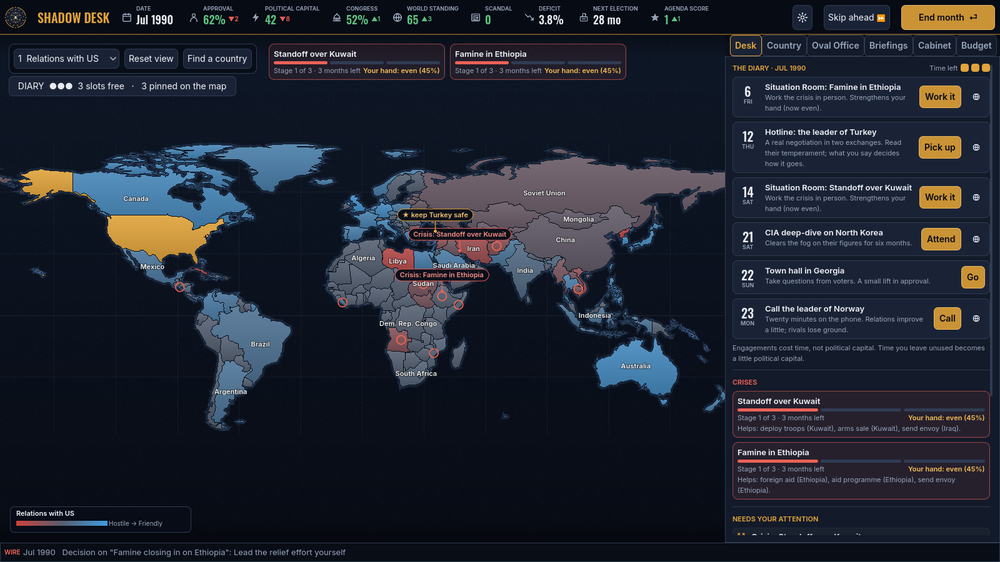

# Shadow Desk



**The world is on your desk.** Shadow Desk is a geopolitical strategy game in the spirit of the early-90s presidential world-power simulations. You run US foreign policy one month at a time: read your daily brief, weigh seven advisors who each want something different, and decide where to send envoys, aid, sanctions, spies or the Marines. Then the world answers.

Version 1.6.0 · Godot 4.7 · macOS, Windows, Linux

## Features

- **Two eras.** 1990 Classic (the Cold War ends, Iraq eyes Kuwait, the USSR may collapse under you) and 2026 Modern (war in Europe, a tense Taiwan Strait, an AI race, a coup belt across the Sahel).
- **A living world.** About 170 countries with economies, stability, hunger, freedom, armies and opinions of you, seeded from World Bank data. Coups, civil wars, invasions and famines happen whether you act or not.
- **Rival powers.** China, Russia (or the Soviet Union) court countries with loans and arms. Win them back or watch the map turn red.
- **Sustained operations.** Run air campaigns, full invasions, war support for allies, aid programmes, charm offensives and covert campaigns that continue month after month until you stop them or the money runs out.
- **A cabinet with opinions.** Seven advisors, each with a photographic portrait and their own voice, brief you, argue, and resign if you ignore them. Your intelligence is only as good as your CIA Director.
- **Voiced briefings.** Crisis cards arrive as pages of the President's Daily Brief, with the advisor who wrote them on a secure video link reading it to you in a natural neural voice.
- **93 events and five kinds of crisis**, from the Gulf War and the Soviet coup to Arctic standoffs and deepfakes, plus a monthly newspaper and election-night returns.
- **Term mandates.** Three concrete goals each term, drawn from the live world and flavoured by your agenda. Meet them for approval and political capital.
- **Defence pacts and credibility.** Sign pacts with close friends. When one is attacked, honour it or watch every ally reconsider.
- **UN Security Council votes** and multi-month story arcs that remember what you did.
- **Presidential Library.** Every presidency is recorded, with 19 achievements to earn.
- **The President's diary.** Every month brings five or six dated engagements (calls to leaders, state dinners, CIA deep-dives, lunches on the Hill, town halls) and time for three. They cost time, not political capital, and each resolves on the spot.
- **See what you did.** Every briefing option shows what it costs and is likely to change; every decision ends with what it actually changed. At End month the month plays out day by day on the map.
- **The map is the to-do list.** Pins mark what needs you. Click a country for a ring of the four option types, with your cabinet's pick in gold.
- **Crises with a clock.** Hostage-takings, border standoffs, a race for the bomb, famines and coup plots run for three or four months. Work them with diary time and the right moves; your hand is your chance that they end well.
- **Hotline calls.** Short negotiations with the leaders who matter, known only by office and temperament. How you open and what you offer moves their mood.
- **Advisors who argue.** When the cabinet is split, two advisors make their case on the briefing, in their own voices.
- **Never lost.** The Desk tab lists your diary, what needs attention and everything you have running.
- **Leader archetypes and the strongman path.** Play an Idealist, a Warlord, a Paranoid or a Strongman. Muzzle the press, pack the courts, rig the election, seize a third term, and live with the protests, impeachment drives, restless generals and assassins that follow.
- **Five agendas, three difficulty levels, nine ways to end.** Win re-election, get impeached, lose your cabinet, or worse. History grades you at the end.

## Play from source

1. Install [Godot 4.7](https://godotengine.org/download) (standard build). On macOS: `brew install --cask godot`.
2. Import once, then run:

```
./tools/run.sh
```

or by hand:

```
godot --headless --path . --import
godot --path .
```

Opening the project in the Godot editor also works: Import, select `project.godot`, then press F5.

> Skipping the import on a fresh copy gives "Could not find type GameState" parse errors. Godot has to build its `.godot/` cache once.

## Controls

| Input | Does |
| --- | --- |
| Click a country | Open its action ring on the map and its dossier: stats, cabinet picks, options by type |
| Click a pin | Jump to the country with the suggested option ready |
| Double-click / scroll / pinch | Zoom |
| Drag / two-finger scroll | Pan |
| `1`–`6` | Map views: relations, stability, hunger, freedom, military, blocs |
| `Enter` | End the month (the month plays out on the map; click or press a key to skip) |
| `Shift+Enter` | Skip ahead until something needs you (up to 6 months) |
| `1`–`4` on a briefing | Pick an option; `Space` finishes the typewriter text |
| `Esc` | Deselect, then pause menu |
| `Cmd/Ctrl+F` | Find a country |
| `Cmd/Ctrl+S`, `Cmd/Ctrl+L` | Save, load (the game also autosaves every month) |
| `F11` | Fullscreen |

## Builds

Release builds for all three platforms come from `tools/export_all.sh` (needs Godot 4.7 and its export templates):

```
./tools/export_all.sh
```

| Platform | Output | Notes |
| --- | --- | --- |
| macOS | `build/macos/ShadowDesk.zip` | Universal (Apple Silicon + Intel). Not notarised: first launch needs right-click > Open. |
| Windows | `build/windows/ShadowDesk.exe` | x86_64, single executable with embedded data and the Shadow Desk icon. |
| Linux | `build/linux/ShadowDesk.x86_64` | x86_64. Voiced briefings need `speech-dispatcher`. |

To sell on itch.io or Steam, you'll want an Apple Developer ID to sign and notarise the Mac build (set it in the macOS export preset) and, optionally, a code-signing certificate for Windows. See [docs/STORE.md](docs/STORE.md) for store-page copy.

## Saves

Saves and settings live in a `ShadowDesk` folder in the player's app-data directory: `~/Library/Application Support/ShadowDesk` on macOS, `%APPDATA%\ShadowDesk` on Windows, `~/.local/share/ShadowDesk` on Linux. The game autosaves every month.

## Voiced briefings

Every briefing is pre-recorded with neural voices, a distinct voice for each cabinet seat, and plays over a secure video link to the advisor. Country names are recorded separately and stitched in, so templated events ("Famine warning: Sudan") are voiced too. The rare line without a recording falls back to your operating system's text-to-speech voice. Toggle voices, volume and speed in Settings.

Recordings and the photographic portraits are generated at build time:

```
pip install kokoro-onnx soundfile torch diffusers transformers accelerate peft
python3 tools/build_voices.py --models /path/to/kokoro          # kokoro-v1.0.onnx + voices-v1.0.bin
python3 tools/build_photo_portraits.py --models /path/to/models  # rv51/, vae/, lcm/
```

## Project layout

```
scripts/sim/        Simulation core: pure GDScript, no scene tree, deterministic per seed
scripts/autoload/   Game (state owner), Audio (music, SFX, voice), Settings
scripts/ui/         Map, panels, briefing cards, newspaper, election night, menus, tutorial
data/scenarios/     Scenario packs (JSON): see docs/MODDING.md
data/map/           Natural Earth 1:110m country shapes, projected, with neighbours
data/source/        Cached World Bank indicators
assets/             Portraits, icons, music, SFX, fonts (all generated by tools/ except fonts)
tools/              Data, art and audio generators; export and run scripts
tests/              Headless tests and strategy-bot balance runs
```

## Tests

```
godot --headless --path . -s tests/run_tests.gd        # invariants, determinism, save/load
godot --headless --path . -s tests/balance.gd -- 10 normal   # strategy bots x scenarios
```

## Rebuilding generated content

```
pip install shapely cairosvg numpy scipy
python3 tools/fetch_worldbank.py                       # data/source/worldbank.json
python3 tools/build_map.py ne_110m_admin_0_countries.geojson
python3 tools/build_scenarios.py ne_110m_admin_0_countries.geojson
python3 tools/build_photo_portraits.py                 # photo portraits (see Voiced briefings); build_portraits_vector.py is the old vector set
python3 tools/build_icons.py
python3 tools/build_audio.py                           # needs ffmpeg with libvorbis
```

## Credits and licences

See [docs/THIRD_PARTY.md](docs/THIRD_PARTY.md). In short: Godot (MIT), Oswald/Inter/Courier Prime fonts (SIL OFL), World Bank data (CC BY 4.0, attribution in-game), Natural Earth (public domain). All portraits, icons, music, sound effects, advisors and event writing are original to this project. No code, art, text or audio from the 1993 game is used.
