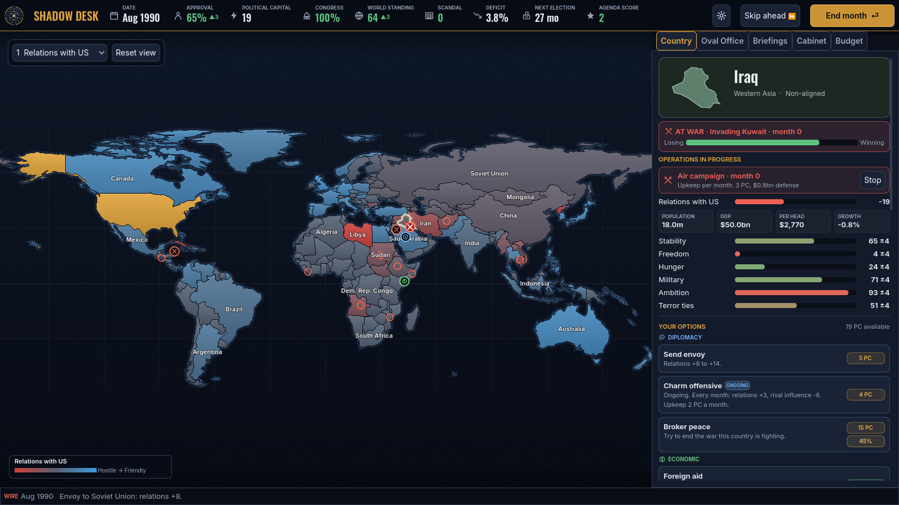

# Shadow Desk



**The world is on your desk.** Shadow Desk is a geopolitical strategy game in the spirit of the early-90s presidential world-power simulations. You run US foreign policy one month at a time: read your daily brief, weigh seven advisors who each want something different, and decide where to send envoys, aid, sanctions, spies or the Marines. Then the world answers.

Version 1.1.0 · Godot 4.7 · macOS, Windows, Linux

## Features

- **Two eras.** 1990 Classic (the Cold War ends, Iraq eyes Kuwait, the USSR may collapse under you) and 2026 Modern (war in Europe, a tense Taiwan Strait, an AI race, a coup belt across the Sahel).
- **A living world.** About 170 countries with economies, stability, hunger, freedom, armies and opinions of you, seeded from World Bank data. Coups, civil wars, invasions and famines happen whether you act or not.
- **Rival powers.** China, Russia (or the Soviet Union) court countries with loans and arms. Win them back or watch the map turn red.
- **Sustained operations.** Run air campaigns, full invasions, war support for allies, aid programmes, charm offensives and covert campaigns that continue month after month until you stop them or the money runs out.
- **A cabinet with opinions.** Seven illustrated advisors brief you, argue, and resign if you ignore them. Your intelligence is only as good as your CIA Director.
- **Voiced briefings.** Crisis cards arrive as pages of the President's Daily Brief, read aloud by the advisor who wrote them.
- **83 events**, from the Gulf War and the Soviet coup to Arctic standoffs and deepfakes, plus a monthly newspaper and election-night returns.
- **Four agendas, three difficulty levels, six ways to end.** Win re-election, get impeached, lose your cabinet, or worse. History grades you at the end.

## Play from source

1. Install [Godot 4.7](https://godotengine.org/download) (standard build). On macOS: `brew install --cask godot`.
2. Import once, then run:

```
./tools/run.sh
```

or by hand:

```
godot --headless --path . --import
godot --path .
```

Opening the project in the Godot editor also works: Import, select `project.godot`, then press F5.

> Skipping the import on a fresh copy gives "Could not find type GameState" parse errors. Godot has to build its `.godot/` cache once.

## Controls

| Input | Does |
| --- | --- |
| Click a country | Open its dossier: stats, actions, cabinet advice |
| Double-click / scroll / pinch | Zoom |
| Drag / two-finger scroll | Pan |
| `1`–`6` | Map views: relations, stability, hunger, freedom, military, blocs |
| `Enter` | End the month |
| `Shift+Enter` | Skip ahead until something needs you (up to 6 months) |
| `1`–`4` on a briefing | Pick an option; `Space` finishes the typewriter text |
| `Esc` | Deselect, then pause menu |
| `Cmd/Ctrl+S`, `Cmd/Ctrl+L` | Save, load (the game also autosaves every month) |
| `F11` | Fullscreen |

## Builds

Release builds for all three platforms come from `tools/export_all.sh` (needs Godot 4.7 and its export templates):

```
./tools/export_all.sh
```

| Platform | Output | Notes |
| --- | --- | --- |
| macOS | `build/macos/ShadowDesk.zip` | Universal (Apple Silicon + Intel). Not notarised: first launch needs right-click > Open. |
| Windows | `build/windows/ShadowDesk.exe` | x86_64, single executable with embedded data and the Shadow Desk icon. |
| Linux | `build/linux/ShadowDesk.x86_64` | x86_64. Voiced briefings need `speech-dispatcher`. |

To sell on itch.io or Steam, you'll want an Apple Developer ID to sign and notarise the Mac build (set it in the macOS export preset) and, optionally, a code-signing certificate for Windows. See [docs/STORE.md](docs/STORE.md) for store-page copy.

## Saves

Saves and settings live in a `ShadowDesk` folder in the player's app-data directory: `~/Library/Application Support/ShadowDesk` on macOS, `%APPDATA%\ShadowDesk` on Windows, `~/.local/share/ShadowDesk` on Linux. The game autosaves every month.

## Voiced briefings

Briefings are read by your operating system's text-to-speech voices, so they work offline and with any event text. macOS and Windows include voices out of the box; on macOS you can add higher-quality voices in System Settings > Accessibility > Spoken Content > System Voice > Manage Voices. Toggle voices, volume and speed in Settings.

## Project layout

```
scripts/sim/        Simulation core: pure GDScript, no scene tree, deterministic per seed
scripts/autoload/   Game (state owner), Audio (music, SFX, voice), Settings
scripts/ui/         Map, panels, briefing cards, newspaper, election night, menus, tutorial
data/scenarios/     Scenario packs (JSON): see docs/MODDING.md
data/map/           Natural Earth 1:110m country shapes, projected, with neighbours
data/source/        Cached World Bank indicators
assets/             Portraits, icons, music, SFX, fonts (all generated by tools/ except fonts)
tools/              Data, art and audio generators; export and run scripts
tests/              Headless tests and strategy-bot balance runs
```

## Tests

```
godot --headless --path . -s tests/run_tests.gd        # invariants, determinism, save/load
godot --headless --path . -s tests/balance.gd -- 10 normal   # strategy bots x scenarios
```

## Rebuilding generated content

```
pip install shapely cairosvg numpy scipy
python3 tools/fetch_worldbank.py                       # data/source/worldbank.json
python3 tools/build_map.py ne_110m_admin_0_countries.geojson
python3 tools/build_scenarios.py ne_110m_admin_0_countries.geojson
python3 tools/build_portraits.py                       # needs cairosvg
python3 tools/build_icons.py
python3 tools/build_audio.py                           # needs ffmpeg with libvorbis
```

## Credits and licences

See [docs/THIRD_PARTY.md](docs/THIRD_PARTY.md). In short: Godot (MIT), Oswald/Inter/Courier Prime fonts (SIL OFL), World Bank data (CC BY 4.0, attribution in-game), Natural Earth (public domain). All portraits, icons, music, sound effects, advisors and event writing are original to this project. No code, art, text or audio from the 1993 game is used.
